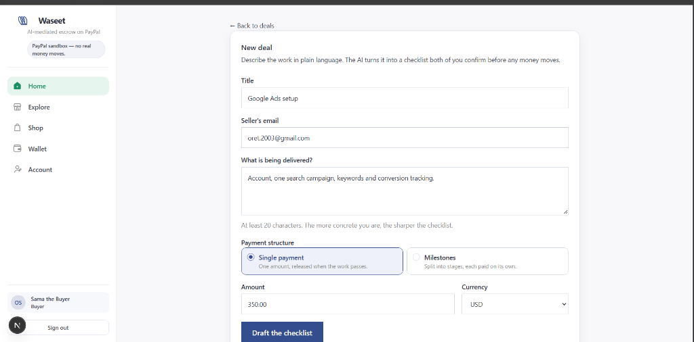
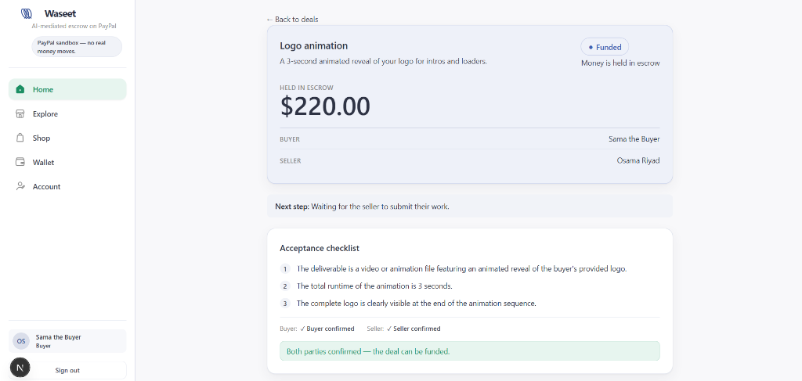
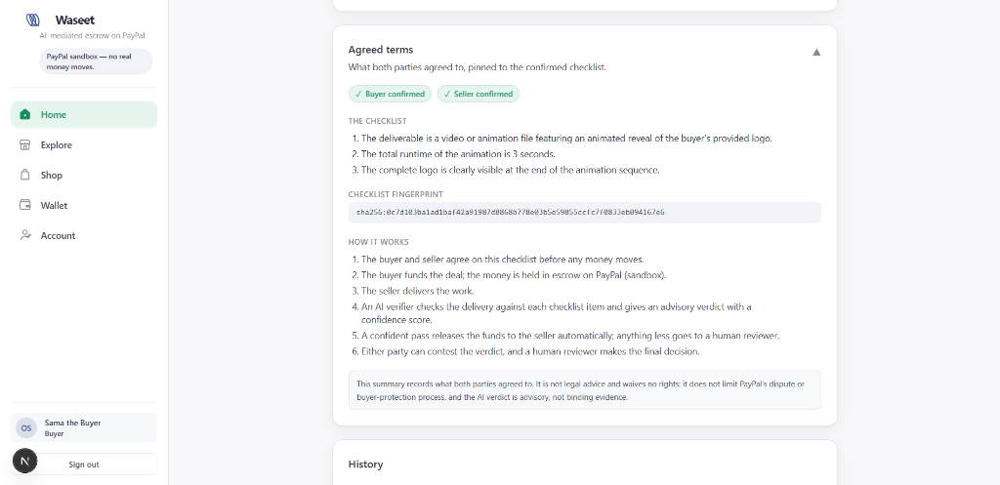
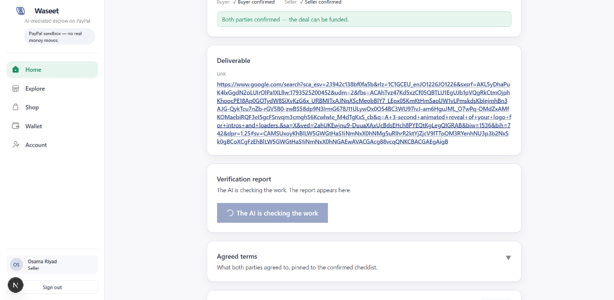
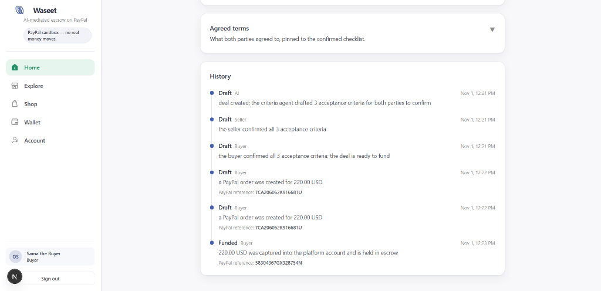

# Waseet — Visual Walkthrough & Screenshots

This directory contains high-fidelity screenshots illustrating the end-to-end Waseet escrow workflow on PayPal.

---

## Core Escrow Lifecycle

### 1. Deal Creation & Payment Structure
Buyers create an escrow deal in plain English. They can choose between single payment or milestone-based progress funding, set counterparty details, and request AI-drafted acceptance criteria.

---

### 2. Funded Escrow on PayPal Rails
Once both parties confirm the acceptance criteria, the buyer funds the deal via PayPal. The capture is locked safely in platform escrow (`FUNDED`), visible to both counter-parties.

---

### 3. Agreed Terms & Cryptographic Fingerprint
Both buyer and seller independently confirm each criterion. A SHA-256 checklist fingerprint pins the exact terms to prevent retrofitted or modified expectations.

---

### 4. Deliverable Submission & AI Verification
The seller submits their work (link, file, or repo). The explainable AI verifier inspects the deliverable against each agreed criterion to generate an advisory verdict.

---

### 5. Immutable Audit Trail & PayPal Transaction References
Every state transition is recorded in an append-only database audit log alongside its verified PayPal order and capture references.

---

## Full Catalog of Screenshots

| File | View / Feature |
|---|---|
| `25-new-deal-form-milestones.png` | Deal creation with milestone and single payment options |
| `26-deal-funded-escrow-summary.png` | Deal funded banner ($220.00 Held in Escrow) |
| `27-agreed-terms-checklist-fingerprint.png` | Verified checklist criteria with SHA-256 fingerprint |
| `28-deliverable-ai-verifying.png` | Seller deliverable submission and AI verification in progress |
| `29-deal-history-paypal-audit.png` | Complete chronological deal history and PayPal transaction references |
| `01-home-deals.jpg` | Buyer Deals Dashboard |
| `02-explore-marketplace.jpg` | Explore Marketplace & Services |
| `03-shop-search.jpg` | Shop & Product Catalog Search |
| `06-wallet.jpg` | User Wallet with balance aggregation |
| `07-account.jpg` | User Account & Verification profile |
| `10-admin-dashboard.jpg` | Admin Reviewer Operations Dashboard |
| `13-login-page.jpg` | Sign-in page |
